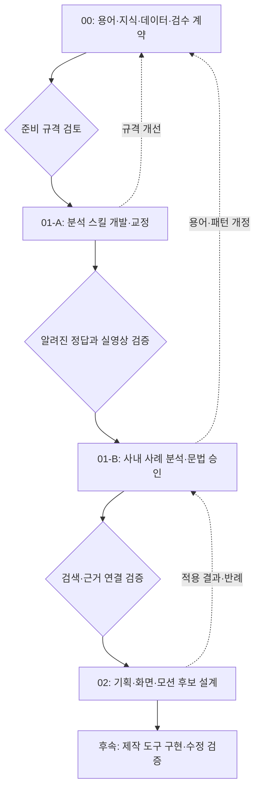

> 전체 로드맵 최신 2026-10-16: A5a 추천 A안의 평가·반복·자료/구간·공수 설계를 완료했습니다. [A5a 결과 보고](<D:/00작업/2026-10-02_AI 기반 영상 기획·제작 스킬 체계 개발 및 검증/Phase 01-A/05_결과보고/16_01-A5a_평가기준과_별도확인_설계보고.md>)와 [실행 계약](<D:/00작업/2026-10-02_AI 기반 영상 기획·제작 스킬 체계 개발 및 검증/Phase 01-A/00_진행안내/25_01-A5a_평가실행계약.md>)을 우선 적용합니다. A5b는 사용자 판단 대기이며 실제 분석0회입니다. 기존 A1~A4 결과와 아래의 이전 상태는 이력으로 보존합니다.

# 회사 영상 문법 기획 스킬 파이프라인 계획 v0.3

기준일 2026-10-16. Phase 00 기반·R8-4 한정 기술검수와 01-A1~A4의 개발·시험 결과를 유지한다. 현재 분석 스킬은 0.1.0-draft.3이며 다음은 A5의 평가 기준·별도 확인 자료·검수 자원 고정이다. A5 실험은 미실행이다.

현재 실행 순서는 [01-A 진행계획](07_Phase01-A_진행계획.md)과 [A5 진행계획](<../Phase 01-A/00_진행안내/22_01-A5_진행계획.md>)을 따른다. 수정 방향의 단계별 범위는 [반영표](08_수정방향_단계별반영.md)에 정리했다. 초기 계획의 A1~A7 기능 묶음은 이번에 실제 진행 중인 A1~A6 단계명으로 정렬했다.

## 먼저 읽을 결론

Phase 00은 분석과 기획이 같은 말을 쓰고, 같은 근거를 조회할 수 있게 만드는 단계다. 용어·데이터 계약·원칙·평가 방법을 준비한다. 회사 영상을 실제로 분해하는 기능은 01-A에서 개발하고, 회사 고유의 규칙을 확정하는 작업은 01-B에서 수행한다. 새로운 화면을 설계하는 판단 스킬은 02에서 만든다.

Taste·레이아웃 스킬의 조사와 다운로드·분해는 00에 포함한다. 그러나 외부 스킬의 취향을 회사 기준으로 승인하거나, 신규 영상의 스타일 프레임을 만드는 일은 00의 완료 조건에 넣지 않는다. 00에서 준비한 지식은 01-A의 **화면을 정확히 기술하는 언어**와 02의 **대안을 설계하는 판단 기준**에 각각 사용한다.

작업 방식과 데이터 형식을 정하고, 제공된 회사 디자인 자료에서 컬러 입력 기반을 확보했다. 브랜드·명암 스케일은 Storybook, 강조색·중립색은 Vercel을 사용한다. UI 규격은 참고 전용이다. 영상 전용 폰트 수치·모션 수치, 회사 영상 문법, 분석 정확도, 스킬의 효과는 자료와 테스트가 확보되기 전까지 미정이다. 상세 정리는 `../Phase 00/03_한맥디자인/00_디자인안내.md`에 있다.

## 입력 대화의 정제

최초 정제 입력은 사용자가 붙여넣은 텍스트 전체였다. 이후 2026-10-14 지정 작업 폴더의 초기 기획 PDF 10페이지를 확인했고, 초기 기획 요약과 이 파이프라인을 연결했다. 파일명 v5와 본문 v4 표시 차이는 원본에 남겨 두었다. 텍스트에서 언급된 별도 Blueprint ZIP은 미확보다.

| 유지할 방향 | 정제한 해석 |
|---|---|
| 최신 회사 영상 중심으로 시작 | 영상 유형뿐 아니라 전달 목적·정보 관계·표현 구조의 차이를 보고 표본을 고른다. 최신 순만으로 반복 사례를 채우지 않는다. |
| 시나리오 → 화면 → 모션을 연결 | 원래 시나리오, 실제 내레이션·자막, 최종 화면을 별개로 기록하고 대응 관계를 연결한다. 불일치도 데이터다. |
| 카테고리가 달라도 같은 문법일 수 있음 | 영상 유형은 자산 수준, 전달 목적·레이아웃·모션은 구간 수준으로 분류한다. 패턴과 사례는 다대다 연결한다. |
| 회사 문법 우선, 외부 대안 보완 | 승인된 내부 패턴을 우선 조회하되 적합하지 않으면 이를 명시하고 외부·새 대안을 제안한다. 내부 패턴을 억지 적용하지 않는다. |
| MP4만으로 모션을 분석 | 보이는 상태·움직임을 기록한다. 원본 AE 키프레임, 이징 핸들, 레이어 스케일·오퍼시티의 정확한 값은 동일한 결과를 만드는 설정이 여러 개일 수 있다. |
| GitHub 스킬을 분해·재구성 | 원본 주소·커밋·파일별 이용 조건·도구 의존성을 확인한다. 원문을 통째로 합친 초대형 SKILL.md를 만들지 않는다. |
| 처음부터 자산과 명칭 통일 | 핵심 축·ID·버전·관측/추론 구분을 고정한다. 세부 용어는 별칭·폐기·병합 이력으로 확장한다. |

대화 속 “높은 분석 정확도”, “스킬만 있으면 가능한 기능”, “재분석 불필요”는 검증된 결과가 아니다. 특히 장면 검출은 컷 후보 검출이며, 모션그래픽의 전체 화면 변화가 실제 컷이라고 단정할 수 없다. 재분석도 원본 변경·분류 변경·근거 부족 구간에서는 필요하다.

## 단계와 경계

Phase 03은 후속 실행·효과 확인을 위한 자리만 정의한다. 이번 계획에서 제작 도구를 미리 고정하지 않는다. AE, 동료 편집 프로그램, 코드 기반 영상 중 어떤 환경으로 전달할지는 별도 실행 계약으로 정한다.

| 단계 | 핵심 질문 | 수행할 일 | 결과물 | 이 단계에서 하지 않을 일 |
|---|---|---|---|---|
| 00 | 같은 표현을 같은 말·근거·기준으로 기록할 수 있는가? | 공개 지식·스킬 조사, 분류 축, 출처 기록, 원칙 DB 설계, 자산·분석 기록 형식, 평가 규격 | 공통 용어·원칙 초안, 소스 비교표, 데이터 명세, 테스트 설계, 자료 준비표 | 회사 문법 확정, 분석 자동화 구현, 새 시나리오의 최종 시안 |
| 01-A | 입력 영상에서 필요한 사실을 안정적으로 추출할 수 있는가? | 전처리·PTS 기록·분할·프레임·시나리오 대응·상태 분석·보고서·검증 구현 | Company Video Grammar Analyzer v0.1, 실행 로그, 비교 평가, 한계표 | 회사 영상 전체 일괄 분석, 신규 패턴 자동 승인, 화면 창작 기능 추가 |
| 01-B | 회사의 반복되는 선택과 적용 조건은 무엇인가? | 최신 대표 영상 분석, 제작자 확인, 공통/프로젝트별 구분, 패턴·변형·반례 검수 | 승인된 사내 문법 DB, 회사 디자인 시스템 초안, 검색 가능한 사례 | 외부 취향을 회사 규칙으로 승격, 납품 승인과 문법 승인 혼동 |
| 02 | 새 내용에 어떤 화면·시간 구조가 적합한가? | 내부 검색, 대안 확장, 후보 비교, 화면·모션 기획 스킬 개발 | Scene Planner / Scene Composer / Motion Director, 기획안·선택 이유 | 신규 디자인 판단을 과거 제작자의 의도처럼 기록, 구현 성공 없이 효율 주장 |

## Phase 00 세부 작업 순서

### 00-1. 범위·준비물·검수자 정의

첫 작업은 정보 전달형 회사 영상으로 범위를 둔다. 인물 연기·실사 VFX·복잡한 3D 역공학을 초기 분석 필수 기능으로 두지 않는다. SW 소개·기술 설명·회사 소개처럼 유형이 다르면서 전달 구조를 비교할 수 있는 후보를 준비한다.

자료 제공자가 준비할 최소 자료는 최종 영상, 시나리오, 프로젝트명·날짜·버전, 최종 승인 상태다. 시나리오가 없으면 실제 전사와 OCR을 대체 입력으로 쓸 수 있으나 “원래 기획 의도 확인” 항목은 비워 둔다. AE 원본은 필수 입력이 아니며, 있으면 수치 대조용 정답으로 쓴다.

디자인 검수자와 업무·내용 검수자를 정한다. 소규모 시작에서는 같은 사람이 맡아도 판단 종류는 기록상 분리한다. 원칙·용어 설계자는 분석의 관측 사실을 승인하며, 회사 표현 규칙의 최종 책임자는 회사 기준을 확정한다.

### 00-2. 공개 스킬 조사·분해·출처 고정

먼저 본문과 실제 실행 파일을 확보하고, 다음을 기록한다: 원본 URL, 고정 커밋, 파일 해시, 이용 조건 파일, 입력/출력, 외부 통신, 실행 환경, 재사용할 판단, 제외할 규칙, 채택 단계.

이번 조사로 공개 저장소 11개를 프로젝트 `../Phase 00/backup/2026-10-14_기반정리전/research/snapshots/`에 검토용으로 확보했다. `../Phase 00/backup/2026-10-14_기반정리전/research/source-lock.json`에 커밋·다운로드 파일·해시가 있다. 전역 스킬로 설치하거나 원본 실행 스크립트를 실행하지 않았다. 다운로드한 전체 파일이 모두 심층 검토된 것은 아니다. 핵심 진입 지침과 관련 데이터·스크립트는 구조·충돌 중심으로 검토했고, 실행 보조물의 전체 동작 검증은 01-A로 남긴다.

Taste를 채택하되 “원본 전체 자동 실행”과 “판단 기준 선별”을 구분한다. 현재 원본의 임의 방향 선택, 랜딩 페이지 문법, 브라우저 검사, 이미지 수집을 영상 분석의 필수 동작으로 가져오지 않는다. 상세 채택표는 `../Phase 00/backup/2026-10-14_기반정리전/01_스킬_소스_검토.md`에 있다.

### 00-3. 공통 용어와 다중 분류 축 설계

각 표현에 안정적인 프로젝트 ID, 한국어 이름, 영어 이름, 정의, 동의어, 적용/제외 예, 상위 개념, 개정 상태를 부여한다. 이 ID는 프로젝트 내부 규약이며 외부 공인 표준이라고 쓰지 않는다.

| 축 | 기록 단위 | 예 | 혼동 방지 |
|---|---|---|---|
| 영상 유형 | 원본 자산 | SW 소개, 기술 설명, 기업 브랜딩 | 화면 레이아웃과 분리 |
| 전달 목적 | 구간·주장 | 순서 설명, 비교, 인과, 공간 이해, 핵심 강조 | 실제 효과와 기획 의도 구분 |
| 정보 관계 | 구간 | 순차, 병렬, 계층, 부분/전체, 변화, 상관 | 같은 전달 목적에도 여러 관계 가능 |
| 레이아웃 | 상태·구간 | 좌우 비교, 수평 프로세스, 중심/주변, 지도+콜아웃 | 그림 스타일·구현 도구와 분리 |
| 모션 기능 | 모션 비트 | 주목 이동, 관계 연결, 진행 표시, 맥락 유지 | 의미·역할 |
| 모션 구현 | 대상·속성 | 이동, 크기 변화, 마스크 공개, 가시성 변화 | 보이는 변형·기법 |
| 시간 특성 | 모션 비트 | 선행/중첩/지연, 유지, 가속/감속 | 밀리초 숫자만으로 문법을 정의하지 않음 |
| 아트디렉션 | 프로젝트·상태 | 팔레트, 폰트, 재질, 촬영/일러스트, 선/면 스타일 | 회사 공통과 프로젝트별 변형 분리 |

`페이드인/투명도 등장/opacity in`은 동의어 후보지만, 가시성 증가가 곧 오퍼시티 증가라는 뜻은 아니다. 화면에서는 `VISIBILITY_REVEAL`, 원본 또는 조건부 추정에서는 `OPACITY_CHANGE`로 나눈다. `카드형`과 `분할형`도 서로 배타적인 단일 카테고리가 아니라 복합 태그를 허용한다.

### 00-4. 원칙과 상투적 화면 방지 지침의 지식 DB 설계

애니메이션 12원칙, Jorge R. Canedo Estrada의 모션 10원칙, 정보 위계·정렬·근접성·시각화 선택·타이포·시간적 가독성을 별도 지식 집합으로 관리한다. 서로 비슷한 원칙은 관련 ID로 연결하고 원래 출처와 체계는 유지한다. 서로 다른 22개 원칙을 22개의 의무적 체크박스로 만들지 않는다.

12원칙은 Adobe 공식 설명, 10원칙은 강사의 Learn Squared 공식 강의 목록과 사용자 지정 POLYUM 글을 대조했다. “모션 10원칙”은 이 강사의 정리 체계로 표기하고 유일한 국제 표준처럼 쓰지 않는다. 상세 원칙 목록과 실무 적용 조건은 `../Phase 00/backup/2026-10-14_기반정리전/02_지식DB_설계.md`에 있다.

지식 항목은 짧은 정의만 저장하는 대신 **언제 고려하는가 / 언제 쓰지 않는가 / 분석에서 무엇을 관찰하는가 / 설계에서 무엇을 결정하는가 / 검수 질문 / 근거 자료**를 저장한다. 원문 GIF·유료 강의·영상은 재배포하지 않고 링크한다. 향후 우리 팀이 만든 좋은 예·실패 예를 구간 ID로 연결한다.

Taste에서 얻을 주요 질문은 “이 화면이 실제 주제와 정보 관계에서 나왔는가?”, “무엇을 먼저 보게 하는가?”, “반복 카드·동일 크기·장식이 내용 구분을 대신하지 않는가?”다. 카드, 중앙 정렬, 그라디언트, 동시 등장, 선형 모션을 일괄 금지하지 않는다. 목적에 맞는 선택이라면 유지한다.

### 00-4A. 한맥 디자인 자료를 영상용 지식으로 정제

제공된 한맥 Storybook과 디자인 정리 앱을 대조했다. 사용자 결정에 따라 브랜드 3색·명암 24색은 Storybook, 강조·중립 6색은 Vercel 값을 전역 컬러 라이브러리로 등록했다. 값이 다른 6개 단계는 Storybook을 선택하고 양쪽 관측값을 함께 보존한다. 흑백 알파 16개, 표면 레시피 18개, 타이포·간격·UI는 선택 참고로 분리했다.

정본은 `../Phase 00/03_한맥디자인/한맥디자인정본.json`, 카테고리 문서·CSS·대비표는 해당 정본에서 생성한다. 실제 영상 문법·전체 운영 DB의 완성을 뜻하지 않는다. 컬러가 전역 사용 가능하다는 것과 모든 장면의 사용 의무를 구분하며, UI·그라데이션·반경·웹 px·hover 시간을 영상 필수 규칙으로 승격하지 않는다. 출처 선택은 확인됐고, 영상 적용 해석과 미제공 수치는 별도 상태로 남긴다.

이 입력 기반의 범위·DB 연결·원문 차이는 `../Phase 00/03_한맥디자인/00_디자인안내.md`와 `../Phase 00/03_한맥디자인/04_출처와_DB_연결.md`를 따른다. 01-B의 회사 디자인 시스템 작업은 이 자료를 다시 추정하는 대신 실제 영상 사례·범위·반례를 연결해 보완한다.

### 00-5. 자산·증거·분석·패턴 데이터 계약

원본 보존과 기록의 단일 기준을 정한다. 초기 권고는 **JSON/JSONL을 정본, Markdown·HTML을 파생 표시, SQLite를 필요할 때 생성하는 검색 인덱스**로 쓰는 것이다. JSON과 MD를 서로 독립 수정하지 않는다. 원본 파일과 모델 입력용 이미지·프로시·재구성 이미지는 별도 관리한다.

개념상 엔터티는 자산, 시나리오 구간, 영상 구간, 상태 프레임, 모션 비트, 근거, 주장, 문법 패턴, 사례-패턴 연결, 디자인 규칙, 분석 실행, 검수 이력이다. 처음부터 12개를 독립 운영하지 않고 최소 기록 묶음으로 시작한다. 분석과 판단은 원본 자산의 해시·버전·타임스탬프로 연결한다.

특히 기록별 상태보다 **주장별 관측/추론/확인불가**가 중요하다. “첫 카드가 커졌다”와 “레이어 Scale이 115%였다”는 다른 주장이다. “강조 효과”와 “제작자가 강조하려 했다”도 분리한다. 상세 필드는 `../Phase 00/backup/2026-10-14_기반정리전/02_지식DB_설계.md`에서 규정한다.

### 00-6. 분석 프로파일과 평가 규격 정의

분석 범위를 세 등급으로 나눈다.

1. **구조 분석(필수)**: 장면 후보, 실제 상태, 화면 위계, 텍스트·대상, 시나리오 대응, 모션 기능과 관측 순서.
2. **시간 분석(필수, 구간별)**: 원본 PTS에 연결된 시작/완료 구간, 유지, 중첩, 상태 변화. 불확실성은 시간 범위로 표시.
3. **수치 추적(조건부)**: 분리·추적 가능한 요소의 좌표·바운딩박스·가시성·곡선 피팅. 카메라·가림·변형·블러·합성·비선형 색 처리로 측정이 불안정하면 중단·한계 기록.

모든 영상에 정밀 곡선 추적을 의무화하지 않는다. 01-A 기본 스킬이 구조·시간 보고서를 만들고, 수치 측정이 재사용 판단에 꼭 필요한 구간만 추가 분석한다. 원본 PTS뿐 아니라 영상/음성의 시작 offset, 잘라낸 구간, 회전·크롭·리사이즈의 시간·좌표 변환을 기록한다.

다중 밀도 추출 정책은 설정값으로 두되, 1fps·8fps·특정 컷 임계값을 보편적 정답으로 고정하지 않는다. 전체 파악은 저밀도 프레임과 경계 후보, 시간 측정은 원본 프레임 근거를 사용한다. 추출 이미지 순번으로 컷 프레임의 시각을 계산하지 않고 PTS·time_base·원본 기준 시각을 저장한다.

### 00-7. 완료 검토와 다음 단계 인계

00의 완료는 회사 영상 문법을 완성했다는 뜻이 아니다. 다음 조건을 검토하고 01-A의 구현 명세로 넘긴다.

- 각 분류 축과 별칭을 구분하며 모호한 화면도 “미분류/복합/신규 후보”로 표현할 수 있다.
- 원칙 12+10에 출처·관련 개념·적용/제외·검수 질문이 있다.
- 외부 스킬마다 채택·변형·보류 부분, 실제 의존성, 이용 조건 확인 상태가 남아 있다.
- 자산 → 구간 → 상태/비트 → 근거/주장 → 패턴 연결을 한 예시로 설명할 수 있다.
- 실제 회사 규칙과 외부 원칙이 섞이지 않으며, AI 추론이 자동 승인되지 않는다.
- 테스트 종류·정답 작성 방식·치명적 실패 조건·비교 방법이 정해져 있다.
- 실제 테스트 자료가 아직 없으면 01-A의 명세 작업은 가능하지만 실영상 통과 판정은 보류한다.

## Phase 01-A 개발 계획

`company-video-grammar-analyzer` 한 개의 분석 진입 스킬과 제한된 로컬 추출·근거 검사 도구를 사용한다. 현재 draft.3의 실제 사용 범위를 확인하며, 범용 디코더나 창작 판단 엔진을 같은 단계에서 완성하지 않는다.

### 실제 진행 단계

| 단계 | 개발과 검증 | 현재 상태 |
|---|---|---|
| A1 | 입력·도구·출력 계약과 고정 합성 진단 | 완료. 보완 후 18/18은 제한 진단 결과 |
| A2 | 작은 실영상 예비 분석과 사용자 확인·누락 보완 | 완료 기록 유지. 기존 사람 확인의 범위를 보존 |
| A3 | 분석 스킬 초안과 선택 7구간 비교·보완 | draft.2 시험 완료. 최초 결과와 두 영향 구간 재시험 보존 |
| A4 | 다른 영상 5개·7원본 구간의 확대 비교 | draft.3 보완 완료. 3구간 재시험과 추가 보정 구분 |
| A5a | 후보·평가 기준·반복·자원·별도 자료 고정 | 수정 방향 반영 계획 작성. 실험 조건은 아직 미확정 |
| A5b | 고정 조건의 별도 자료 확인 | 미실행 |
| A6 | 사용 범위·한계·근거의 최종 재검수와 인계 | 후속 |

정밀 타이밍·수치 추적은 별도 A5 단계명이 아니라 필요한 분석 구간에 적용하는 기능이다. 기존 구조·시간 관측과 조건부 수치 추적의 구분을 유지한다. 실제 전사·전체 재생·정확한 AE 원본값은 검증한 범위로만 보고한다.

이후 스킬 수정은 초안→시험→평가→보완→영향 범위 재시험을 따른다. 이번 로드맵 갱신은 스킬·과거 결과·채점 기준을 변경하지 않는다.

### 교정·평가 규격

정답이 알려진 합성 테스트는 **01-A에서** 만든다: 단순 이동, 가속/감속, 페이드, 마스크, 크기 변화, 동시/순차 등장, 카메라 이동, 짧은 컷과 교차 디졸브. 같은 동작을 FPS·VFR·해상도·압축·배경·가림 조건으로 바꾼다. 합성 예를 회사 사례에 넣지 않는다.

실영상은 최신 대표 2~3편에서 서로 다른 정보 구조를 가진 구간을 선별하는 규모로 시작한다. 숫자는 출발 제안이며 보유 자료의 실제 중복·난이도에 따라 조정한다. 정답 검수는 사람이 표시한 경계·텍스트·정보 관계·등장 순서·시나리오 대응을 사용한다. 디자인 해석에는 단일 기계 정답이 없으므로 분류 합의·근거의 적절성을 검수한다.

| 평가 | 판정 방식 |
|---|---|
| 시간·경계 | 프레임/시간 오차 분포와 이벤트별 누락·오검출을 기록. 교정 영상에서 원본 프레임 근거가 있는 이벤트는 우선 ±1프레임 목표. 어려운 경계는 범위·불확실성으로 기록. 평균만으로 통과시키지 않음. |
| 화면·텍스트 | 주요 대상·문구·관계 누락, 잘못된 OCR, 의미 변화 확인. 문자 인식률과 전달 의미 보존을 구분. |
| 시나리오 연결 | 다대다 대응·미대응·최종 영상 변경을 허용. 원문 문장을 강제 매칭하지 않음. |
| 근거성 | 관측 주장에 유효한 프레임/클립/시나리오 근거가 있고 추론·미측정이 식별되는가. 임의 수치와 없는 화면은 치명 실패. |
| 모션 분석 | 기능 분류·순서·중첩과 수치 추정의 구분. 정밀 측정의 성공률과 함께 중단·미측정률 보고. |
| 다음 단계 인계 | 01-A는 관측·근거·미확정과 문법 후보의 참조 연결을 확인한다. 정보 관계에 맞는 검색·부적합 사례 제외는 01-B, 새 기획의 선택 품질은 02에서 검증한다. |
| 비용·공수 | 추출·API·재시도·사람 검수·유지보수 포함 총 시간과 비용. 지원 부담까지 기록. |

초기 통과 조건은 구조적 오류 0, 치명적 근거 오류 0, 실제 구간에서 검수 가능한 출력, 알려진 정답에서 시간 분석이 사전에 정한 목표를 충족하는 것이다. 필수 이벤트·주요 문구·시나리오 연결의 검출률·완료율·누락·기권을 분모와 함께 보고하며, 모든 항목을 확인 불가로 처리해 통과할 수는 없다. VFR의 ±1프레임은 인접 원본 프레임과 실제 시간 범위로 정의한다. 분류 정확도·기권 허용범위·기획 품질의 수치 목표는 교정·개발 파일럿 뒤 홀드아웃을 보기 전에 고정한다. 목표 변경 시 버전을 남긴다.

비교 실험은 같은 자료·모델·도구·시간 예산에서 **기본 분석 / 공통 용어·스킬 적용 / 필요 시 수치 분석 추가**를 비교한다. 디자이너의 수동 분석을 동일 필수 검수 수준의 업무 기준선으로 추가하고, 프레임 추출 개선과 판단 스킬 개선의 효과를 따로 확인한다. 이미 본 사례와 미사용 프로젝트의 홀드아웃을 프로젝트 단위로 분리한다.

### 수정 방향을 반영한 A5 확인 범위

고정 draft.3의 반복성, 별도 프로젝트에서의 누락·오탐·기권, 원본과 대상·문구·시각 연결, 정착과 가감속의 근거를 확인한다. 분석 목적은 문법 추출용 구조·시간 기록으로 정하고, 정확한 곡선·좌표 측정은 필요한 질문이 있을 때만 추가한다. 실제 검수·수정·추가 추출 부담을 기록하되 과거 미기록 공수나 원제작비는 생성하지 않는다.

기존 A3·A4 결과는 유지하고 새 기준을 소급 채점하지 않는다. 별도 확인 표본은 노출 이력과 기준을 먼저 고정한다. 실패 후 보정한 자료를 다시 처음 보는 확인 자료로 세지 않는다. 상세 조건과 규모 제안은 [A5 진행계획](<../Phase 01-A/00_진행안내/22_01-A5_진행계획.md>)을 따른다.

## Phase 01-B: 회사 문법 구축

최신 대표 영상의 전체 자산 목록을 만들고 내용·시각 유형·정보 구조를 보고 표본을 고른다. 같은 문법을 쓴 나머지 영상도 자산 목록과 사례 연결은 보존하되, 모든 구간을 같은 깊이로 반복 분석하지 않는다.

분석 결과는 후보 상태로 저장한다. 제작자가 확인한 의도와 AI 해석을 분리한다. 반복되는 장면의 **사용 조건과 실패 조건**을 묶어 패턴으로 만들고, 회사 공통/프로젝트 한정/단일 예/외부 원칙으로 구분한다.

패턴 승인에는 실제 사례 링크, 적용 목적, 정보 관계, 레이아웃 변형, 모션 기능, 제약, 검수자·일자·버전이 필요하다. 사례 개수만으로 승인하지 않는다. 기존 납품에서 수정이 많았거나 이해가 어려웠던 반례도 함께 남긴다.

02 진입 전에는 예를 들어 “단계 설명, 요소 6개, 가로 화면, 긴 한국어 문구” 같은 조회에 내부 사례와 제약을 돌려주며, 부적합한 사례를 제외하는지 확인한다. 검색 결과가 없으면 없음으로 응답하고 외부 보완을 제안한다.

### 01-B에서 보완할 재사용 조건과 반례

기존 분류와 ID를 사용해 대표 사례의 전달 목적·정보 관계·모션 기능·사용 조건·제외 조건·반례·근거 수준을 묶는다. 관찰한 동작, 원제작 의도에 대한 해석, 새 업무에 대한 제안을 구분하고 제작자 확인은 해당 주장 범위에만 연결한다. 같은 카드나 전환을 썼어도 정보 관계가 다르면 다른 후보로 검토한다.

첫 후보는 비교·단계·통합 등 대표 표현 3종 내외로 작게 시작할 수 있다. 단순 사례 수로 승인하지 않고, 적합한 조회와 겉모양만 비슷한 부적합 조회를 함께 확인한다. 비용·난이도는 실측·추정·미상을 구분하며 태깅·검수·검색 유지 부담도 기록한다.

## Phase 02: 외부 확장과 기획 스킬

입력 시나리오의 정보 관계·우선순위·시청 조건을 먼저 정한다. 승인된 내부 문법을 조회한 뒤, 적합한 기본안과 필요할 때 외부·새 표현 대안을 만든다. 기본안 역시 기존 프레임을 복사하는 것이 아니라 새 내용·문구 길이·요소 수·화면 비율에 맞게 변형한다.

- Scene Planner: 메시지·시나리오·장면 전달 목적·정보 구조.
- Scene Composer: 2~3개 구조적으로 다른 레이아웃 후보, 위계·여백·대상 크기·읽는 순서, 근거와 절충.
- Motion Director: 확정 화면의 상태 변화·등장/유지/퇴장·주목 이동·시간 관계·내레이션 대응.

화면 확인 → 모션 확인 → 제작 지시서 전달로 책임을 나누되, 시간 설계 중 내용이 과밀하면 화면·장면 구성으로 돌아간다. 정지 화면만 예쁘게 만든 후 움직임을 추가하는 일방향 절차가 되지 않게 한다.

Taste 변형은 이 단계에서 본격 비교한다. **지침 없음 / 회사 문법만 / 회사 문법+선별 Taste**를 동일 조건에서 비교해 내용 이해·브랜드 적합·구도·수정성과 공수를 평가한다. 기존 수동 기획도 기준선으로 포함하며 실제 제작 후 기획 재작업까지 공수에 넣는다. 낯선 화면이 되었다는 이유만으로 성공이라 하지 않는다.

### 02에서 보완할 선택과 제작 자원 판단

공통 제작 명세에 전달 목적·필수 내용·요소 역할·화면 구조·상태와 시간 관계·적용 문법·선택 이유·변경/보호 범위·검수 조건을 연결한다. 화면과 모션은 시간 설계의 문제에 따라 서로 조정한다.

정확성·가독성·필수 브랜드 규정은 공통 조건이다. 기본 재사용·선별 맞춤·대표 표현 탐색을 장면별 자원 배분안으로 비교하고, 추가 수정은 해결할 문제·기대 효과·남은 자원으로 판단한다. 실제 기획·제작·수정·검수·지원·유지 공수를 측정한 뒤 한 제작 경로의 효과부터 확인한다. 새 기획의 적합성·이해도·ROI는 A5의 분석 정확도와 별도로 평가한다.

## 역할·규칙의 우선순위

1. 실제 전달 내용·사실·사용자 요청·출력 조건.
2. 승인된 회사 필수 규칙과 접근·가독성 기준.
3. 프로젝트 아트디렉션과 사용 맥락.
4. 정보 관계에 맞는 레이아웃·모션 판단과 내부 사례.
5. 외부 원칙·Taste·취향 제안.

필수 규칙과 권고 문법은 각각 표시한다. 오래된 내부 권고가 새 업무에 맞지 않으면 반례와 대안을 제시할 수 있다. 외부 지침은 분석 보고서에서 과거 화면을 “수정”하는 명령이 아니라 설명과 평가를 보조하는 자료다.

## 실행 환경과 다음 준비

실제 사용 경로는 격리 런타임의 제한 로컬 추출과 현재 Codex 화면 검토다. 환경·소스 범위·시간/좌표·누락·변형판 처리는 [A4 결과](<../Phase 01-A/05_결과보고/14_01-A4_다른영상_확대시험_결과.md>)와 해당 실행 기록을 따른다. 도구가 설치돼 있다는 사실과 모든 형식의 입력을 지원한다는 판정은 구분한다.

영상 41개와 프로젝트 23묶음의 등록 및 제공 문서 연결은 완료됐다. 자료를 다시 묶거나 시나리오 없는 SW 영상의 원고를 새로 요구하지 않는다. A5는 기존 별도 확인 후보의 노출 이력·문서 경로·자원을 검토하고 아직 미정인 실행 조건을 고정한다. 별도 음성/API 처리가 필요한 경우 해당 자료·도구·비용 범위를 먼저 구체화한다.

## 지금의 완료 범위

Phase 00의 공통 용어·원칙·데이터·검수 기반과 R8-4 한정 기술검수, 01-A1의 합성 진단, A2 실영상 예비 분석·정정, A3 스킬 초안·7구간 시험, A4 확대시험·표적 재시험·보정 결과를 유지한다. 현재 후보는 draft.3이다.

미완료는 A5의 고정 조건 별도 확인, A6 인계, 회사 문법 승인과 새 기획·제작 효과 검증이다. Phase 00의 포괄 완료 확인과 관리 스킬 기본 전환은 기존 상태를 유지하며 이 로드맵에서 대신 승인하지 않는다. 근거는 [현재 읽는 순서](00_최신기획_읽는순서.md), [Phase 00 완료 범위](04_Phase00_완료범위와_01-A_준비안내.md), [단계별 반영표](08_수정방향_단계별반영.md)에서 확인한다.

## 과거 종료 재감사 이력

2026-10-14 재검수에서 Phase 00 전체 종료는 미완료로 판정했다. 최소 기반·파일 확보·정해진 시험 통과와 조사·계약·검수 완료를 구분한다. [종료 재감사](../Phase%2000/08_검증결과/Phase00_종료재감사.md)의 유한한 보완 순서를 따른다.

2026-10-16 갱신에서 위 과거 재감사 기록은 보존했다. 현재 사용 범위는 이 문서의 완료 범위와 최신 Phase 00 안내를 따른다. 변경 전 로드맵은 이번 계획 갱신 backup에서 찾을 수 있다.
