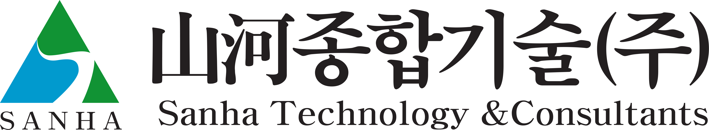

# 산하종합기술 — CI·심볼 자산 안내

회사ID `sanha`. 회사명단은 사용자 확인, 공식 최신CI·지정색·배포범위는 미확인.

## 바로 사용할 파일 찾기

| 파일 / 용도 | 역할 | 원본 연결 |
|---|---|---|
| [산하종합기술_CI_제공원본.png](../../01_%EC%9B%90%EB%B3%B8%EC%9E%90%EB%A3%8C/%EC%82%B0%ED%95%98%EC%A2%85%ED%95%A9%EA%B8%B0%EC%88%A0/%EC%82%B0%ED%95%98%EC%A2%85%ED%95%A9%EA%B8%B0%EC%88%A0_CI_%EC%A0%9C%EA%B3%B5%EC%9B%90%EB%B3%B8.png) | original | 제공 원본 |

## CI 조회

투명 PNG는 밝은 배경에서 확인한다. 원본/변환본 색공간이 같다는 가정으로 서로 덮어쓰지 않는다.

## 화면에서 참고할 관측색

아래는 제공 PNG의 alpha255 픽셀 관측값이다. ICC가 없어 sRGB 표시를 가정했다. 회사 지정색·브랜드 역할 승인값으로 쓰지 않는다.

| 관측값 | 픽셀 근거 |
|---|---|
| `#019ACE` | PNG 원본 픽셀 (395, 424) RGBA=[1, 154, 206, 255] |
| `#119334` | PNG 원본 픽셀 (639, 1) RGBA=[17, 147, 52, 255] |

## AI 원문 색 채널

CMYK/RGB 원문 채널을 보존했다. 프로필·공식 가이드가 없으므로 화면 HEX 자동 변환은 보류한다. 클리핑/그라디언트 내부값은 대표색 역할과 다르다.

| 원문 값 | 원문 위치 |
|---|---|

## 남은 확인

- 제공문서/CI의 공식 권위·최신판 확인과 지정색의 색공간/프로필.
- 밝은/어두운 배경형, 최소 크기·보호 공간, 단색형은 가이드 확인 후 추가.
- 영문 법인명의 공식 표기와 폰트·이미지·도표 자산은 미확보.
- 제공자료는 CI PNG 1개. AI/SVG 원본과 별도 심볼이 없어 벡터 재구성·심볼 분리는 보류. 임의 트레이싱으로 원본을 만들지 않았다.

[전체 목록](../00_회사별자산목록.md)

정본: `10_공용자산/회사목록.json` SHA256 `0b011a9c2962459a3b42067c3f7120602cde9e541c466647fa880a0a298dda2a`, `10_공용자산/자산목록.json` SHA256 `5f4cc581df387e8948bc3071aa9f93bd34fb88a2ffc406aaf72de9f3e8e940a0`, `10_공용자산/CI색상목록.json` SHA256 `c95a79a81a422fc23f4275a8dd878016f209fdaff171d73f44d3cff7387b7097`. 조회문서만 고쳐도 정본은 변경되지 않는다.
