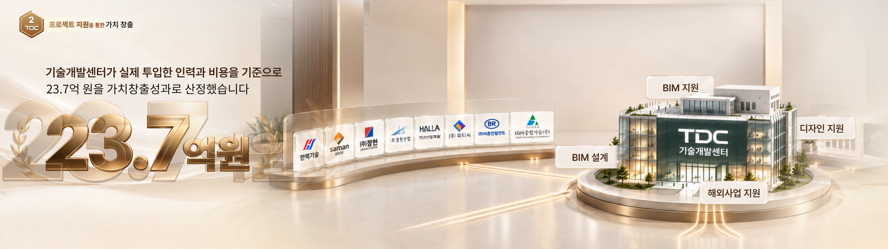

# 실제 기록 검토 — 디자인을 찾아 쓰기 쉬운가

상태: 사용자 피드백 대기. 실제 사용판 draft.10과 후보 draft.11은 수정하지 않았다. 아래는 **기존 수집 기록을 검토하기 쉽게 재편집한 제안**이며, 스킬을 새로 실행해 얻은 성능 결과가 아니다. 원기록과 이전 평가 결과는 보존한다. 숫자·로고·배치가 보이는 특정 시점의 기록이며 정착 화면이나 실제 모션의 증거로 확대하지 않는다.

## 검토 1 — 먼저 읽는 기록의 밀도

### 원본 A: 134초 — 요청과 지원의 관계

**디자인 요약 제안:** 크림색 공간에 흰 유광 정보판 두 개를 나란히 놓고, 가운데 여백의 파란 우향 ‘프로젝트 요청’과 초록 좌향 ‘전문인력 지원’으로 양쪽 역할을 연결한다. 왼쪽은 가족사 로고 8개를 2열×4행으로 정리하고, 오른쪽은 전문인력·지원 항목과 모니터 업무 장면을 결합한다. 큰 역할 제목→작은 설명→내부 목록/업무 이미지의 위계를 쓴다. 모서리의 색 강조·광택 도상·가는 구분선·바닥 반사가 두 판의 표현을 통일한다.

- **기능 해석:** 두 집단과 반대 방향의 관계를 한눈에 읽게 하는 구성. 원제작 의도 확인이 아닌 관측 기반 해석이다.
- **찾아 쓸 단위:** 전체 ‘양쪽 역할판+양방향 관계’ 배치, 회사 타일, 역할 헤더, 라벨 화살표, 업무 이미지 묶음.
- **변형 시 살필 것:** 문구·색·조직 수는 달라질 수 있다. 방향·주체·관계 문구를 함께 확인해야 의미가 유지된다. 구체적으로 다른 항목 수/화면비에 적용한 시험은 없다.
- **모션:** 이 입력은 한 장이므로 등장·이동·정착·퇴장·동시성을 판단하지 않는다. 모션 조사 항목은 디자인 요약과 따로 연결한다.

### 원본 B: 172초 — 성과값·회사 목록·센터의 공간 구성

**디자인 요약 제안:** 왼쪽의 거대한 금색 입체 **23.7억원**, 중앙의 곡선 받침 위 회사 로고열, 오른쪽의 센터 건물과 주변 지원 명찰을 하나의 크림·금색 실내 무대에 배치한다. 설명문은 위쪽, 큰 수치는 아래 전경에 두며 로고열의 원근·건물의 원형 단상·바닥의 반사와 금빛 곡선이 공간을 묶는다. 지원 명찰은 건물 위·좌·우·앞으로 나뉘어 중심 대상과의 소속 관계를 보여준다.

- **수치와 기능 해석:** 원본 설명은 기술개발센터의 실제 투입 인력·비용 기준으로 23.7억 원을 성과로 산정했다는 내용이다. 이 수치의 타당성을 검증한 것은 아니다. 구성은 성과값·관련 회사 집단·센터의 지원 범위를 함께 보여주는 것으로 읽힌다. 회사별 기여액이나 로고별 수치 배분을 뜻하지 않는다.
- **찾아 쓸 단위:** 전체 성과 무대 배치, 성과 수치 조형, 회사 타일/배열, 건물+기단 묶음, 지원 명찰.
- **변형 시 살필 것:** 수치·단위·회사 목록·기관 이미지·지원 항목은 적용값이다. 원본의 금색 스타일을 유지하는 활용과 다른 스타일 활용을 모두 열어둔다. 역할·단위·귀속은 별도로 확인한다.
- **현재 상태와 모션:** 큰 숫자 뒤에 옅고 더 큰 윤곽이 겹쳐 보인다. 이 겹침을 정착 디자인·잔상 효과·카운트업으로 확정하지 않는다. 134초와 172초 사이 로고의 실제 이동도 미관측이다.

### 기록의 뒤쪽에 보존할 상세

요약 때문에 관측을 버리는 제안은 아니다. 원본 시각·해시·로고 8개 이름/순서·네 지원 라벨 위치·레이어처럼 보이는 겹침·책/화분/모니터 구성·정밀 수치·미상·크롭 좌표·검수 이력은 상세 기록과 근거 색인에서 찾게 한다. 요약에는 정보 관계를 바꾸는 핵심 숫자/단위/부정어와 상태 한계를 남긴다. 반복하는 공통 메타데이터는 한 번 정의하고 연결한다.

**현재 검토 제안은 ‘요약+전체 상세+근거’ 구조다.** 정확한 글꼴/픽셀값을 알아야만 디자인을 이해할 수 있게 만들지 않고, 필요할 때는 원본의 구체 외형과 숫자로 돌아갈 수 있게 한다.

## 검토 2 — 부품을 어디까지 나눌지

두 실행은 각각 부품 9종/6종으로 나눴다. 양쪽 모두 전체 사례에는 모니터·건물 등의 내용을 보존했다. 아래는 개수가 아니라 독립 검색 필요성의 차이다.

| 실제 묶음 | 별도 정의로 꺼내는 안 | 전체 배치 안에 상세 보존하는 안 |
|---|---|---|
| A의 모니터 3대+선반+책·화분 | ‘업무 이미지 묶음’으로 검색. 내부 모니터·소품은 구성 설명으로 연결 | 오른쪽 정보판의 상세로 찾음 |
| B의 건물+원형 기단 | ‘기관 중심 대상’ 묶음으로 검색. 지원 명찰은 별도 부품으로 연결 | 전체 성과 무대 안의 중심 대상으로 찾음 |
| 회사 로고 8개 | 공통 타일 정의 하나와 개별 사용처/배치 차이로 기록 | 같은 방식. 로고마다 새 패턴은 만들지 않음 |
| 금색 잎·숫자 뒤 윤곽 | 성과 조형의 하위 구성으로 기록 | 같은 방식. 현재 독립 동작 근거 없음 |

**제안:** 모니터 업무 묶음과 건물+기단은 독립 검색 후보로 두고, 지원 명찰은 별도로 연결한다. ‘같은 원본 자산’이나 ‘반복 검증된 템플릿’으로 승격하지 않는다. 최초 단일 사례도 재사용 후보로는 남길 수 있지만 관측 횟수·검증 상태를 구별한다. 이 선택은 아직 스킬·정본 DB에 반영하지 않았다.

이전 결정인 ‘전체 사례 보존+레이아웃/전체 흐름/독립 세부 동작 연결’은 유지한다. 여기서 검토할 것은 업무 묶음·기관 묶음이 각각 독립 검색할 만한 단위인지다.

## 검토 3 — 관측과 의미 해석의 확정 수준

아래는 192초 원본에서 무배율로 발췌한 구름 도상이다. 새 디자인이 아니다. 원본 크기 7680×2160 기준 크롭 `(4250,1400,4600,1630)`.

| 구분 | 이 경우에 남길 내용 |
|---|---|
| 원본에서 확인 | 중앙 허브 우하단 흰 타일 안, 청록 구름 윤곽과 흰 네 꼭지 반짝임 표식 |
| 근거 없는 식별 | 사람/그룹, 하향 이동·다운로드 표식이라고 확정하지 않음 |
| 가능한 기능 해석 | 중앙 허브 주변의 보조 도상이라는 배치 역할. 어떤 서비스나 기능인지는 미확인 |
| 수집에 미치는 영향 | 형태·위치로 검색하고 전체 디자인 기록은 유지 가능. 서비스 의미별 분류나 방향 모션 정의에는 사용하지 않음 |

이 오류의 정정은 사용자 선호로 고를 사항이 아니다. 실제 화면에 맞게 바로잡아야 한다. 사용자에게 판단받을 것은 **미확정 의미를 본문에서 얼마나 드러내고, 언제 후속 확인을 요구할지**다. 모든 미상을 상세 본문에 반복하면 읽기 어려워지고, 영향 있는 미상을 숨기면 재사용 때 잘못 확정할 위험이 있다.

**제안:** 요약에는 정보 관계·단위·중요 식별·모션 분류를 바꾸는 미상만 표시하고, 나머지 정밀 원값/작은 글자 미상은 상세 색인에 연결한다. 원본의 형태 기록과 서비스 의미에 대한 가설은 구별한다.

## 피드백 뒤 반영할 변경안

사용자 선택에 따라 다음 세 가지를 한 묶음으로 조정한다: ① 첫 화면에 보이는 기록 밀도, ② 업무/기관 묶음의 독립 조회 단위, ③ 해석 미상의 노출·사용 제한. 이 검토안을 기존 스킬의 성공 사례로 넣거나 새 규칙을 이미 승인된 것으로 취급하지 않는다. 선택을 받은 뒤 후보 수정 범위와 필요한 확인만 정한다.

실제 사용판 draft.10 유지. 후보 반영·전편 확장·정본 등록은 보류 중이다. 이번에는 새 분석 실행이나 새 화면 제작을 하지 않았다.

원기록: [후보판 지원 수집](<D:/00작업/2026-10-02_AI 기반 영상 기획·제작 스킬 체계 개발 및 검증/Phase 01-A/05_결과보고/2026-10-19_draft11_오독대응과_조회검토/company-video-grammar-analyzer-workspace/iteration-2/eval-2-repeated-components/with_skill/outputs/collection.md>) / [기준판 지원 수집](<D:/00작업/2026-10-02_AI 기반 영상 기획·제작 스킬 체계 개발 및 검증/Phase 01-A/05_결과보고/2026-10-19_draft11_오독대응과_조회검토/company-video-grammar-analyzer-workspace/iteration-2/eval-2-repeated-components/old_skill/outputs/collection.md>).
