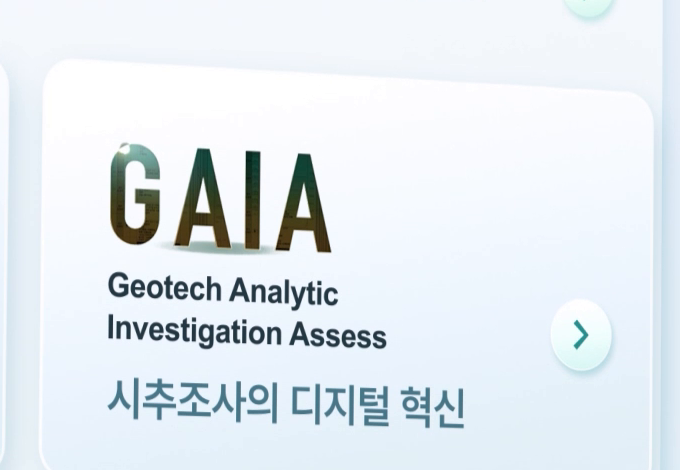

# 실제 수집 기록에서 유지할 것과 고칠 것

이번 검토는 기존 시험의 다섯 정지 표본과 수집 기록을 대상으로 한다. 사용자에게 전편이나 실재생 검수를 대신했다고 보고하지 않는다. 원래 결과 파일과 당시 6개 기준의 평가점수는 보존한다.

직접 볼 기록: [S/W 수집 원기록(draft.10)](previous-results/eval-1-new-section/with_skill/collection.md) / [지원 수집 원기록(draft.10)](previous-results/eval-2-repeated-components/with_skill/collection.md). 사본은 원래 파일과 바이트가 같다.

## 기록 밀도와 부품 단위

프로젝트 지원 기록의 두 화면은 전체 사례를 먼저 보존하고, 로고 타일·정보판 머리부·방향 라벨·업무 이미지 묶음·성과 수치·건물 기단을 별도 조회하도록 했다. 로고 8개나 건물의 창문마다 독립 패턴을 만들지 않은 단위는 현재 목적과 맞는다. 의미가 같은 ‘BIM 지원’이라도 원형 아이콘과 건물 주변 라벨의 외형 부품은 다르다고 남긴 것도 유지한다.

그리드/가로열을 한 배치 가족의 변형으로 두거나 서로 다른 하위 배치로 나누는 두 방식 모두 가능하다. 중요한 것은 2열×4행과 원근 한 줄이라는 구조, 회사 순서 차이, 공통 로고 내용과 동일 자산 미확정을 함께 보존하는 것이다. 번호 개수로 더 나은 분류를 판단하지 않는다.

S/W 기록은 밝은 하늘색 공간·겹판·원근 UI·연결 허브·설명판·수치 위계와 함께 개별 문구/도상을 기록했다. 이 전체 관계는 유지하고, 전사 오류를 고치는 일을 다시 픽셀 좌표 수집으로 확대하지 않는다. 정지 표본만 있으므로 전체 모션/세부 동작은 관측 가능한 상태 차이와 미관측 조사 항목으로 한정한다.

## 국소 정정과 조회 보강

| 기존 기록 | 원본 대조 | 현재 처리 |
|---|---|---|
| iteration-1 / draft.9의 GAIA 설명 ‘지주조사의 디지털 혁신’ | 192초 GAIA 카드에는 ‘시추조사의 디지털 혁신’ | 별도 정정. 과거 결과는 보존하며 정정 없는 문구를 재사용하지 않는다. |
| iteration-1 / draft.10의 O5 ‘별 모양이 있는 사람/그룹’ | 192초 중앙 우하단 타일은 반짝임 표식이 있는 구름 | 형태 이름 정정. 실제 서비스 의미·기능은 확인 없이 붙이지 않는다. |
| draft.10 정의 `LOC-COMP-01@1`, 사용표 `COMP-01` | 문맥으로는 찾을 수 있으나 명시적 별칭표가 없음 | 기존 사례의 연결은 해소 가능하다는 사실과 검색 취약점을 구별한다. 이후 기록은 정식 ID/판본 통일 또는 별칭표를 사용한다. |
| 첫 제품의 스타일화 로고 TOVA/TCVA 전사 차이 | 풀네임 ‘TOtal Vehicle Assignment’와 도안화된 로고는 근거가 다름 | 공식 명칭 확인 전 임의 확정하지 않는다. 형태/위치·풀네임으로 찾을 수 있게 보존한다. |

번호 조회를 보강한 최소 예시는 다음과 같다. 새 정본 등록이나 관측 패턴을 만드는 예시가 아니라 기존 기록의 연결을 명료하게 쓰는 방식이다.

| 사용처 | 정의 | 이번 근거·차이 | 돌아갈 사례 |
|---|---|---|---|
| CASE-01 C1-B, CASE-02 C2-B의 회사 타일 | `LOC-COMP-02@1`과 배치 가족 `LOC-LAYOUT-03@1` | E01 134초 2열×4행 → E02 172초 원근 가로열. HALLA/피티씨 순서 교체. 동일 자산/이동 경로 미확인 | 위 원기록의 §2·§3 전체 구도와 §4 정의 |

따라서 이후 다른 장면에서 이 타일을 찾으면 정의 전체를 다시 쓰기보다 정식 ID/판본과 그 장면의 근거·배치 차이를 연결한다. 앞 장면과 뒤 장면 사이 실제 이동을 봤다는 뜻은 아니다.

원본 크롭은 분석용 무배율 발췌다. 좌표는 7680×2160 원본 기준 `(left, top, right, bottom)`이며 모두 `f_05760_192.000.png`에서 발췌했다.

- GAIA: `(2430,800,3110,1270)` — [원본 크롭](evidence/192_GAIA.png).
- 구름 도상: `(4250,1400,4600,1630)` — [원본 크롭](evidence/192_cloud_star.png).

## 평가 기준을 바꾸는 이유

기존 ‘전체 구성이 맞다’와 ‘ID가 있다’는 중요한 조건이지만 위 오독을 걸러내지 못했다. 새 기준 `source-grounded-2`는 실제 문구/형태, 수치·단위·대상, 방향과 회사 순서, 정의→사용처→이번 근거의 왕복을 각각 확인한다. 모호하면 전부 미상으로 비우는 답도 충분한 수집으로 통과시키지 않는다. 세밀한 미감과 적정 기록량은 점수 하나로 확정하지 않고 사용자 검토로 남긴다.

이번 후보 수정은 이 검토 방법을 일반화한 것이다. 특정 제품 문구·회사 순서·정답 도상을 스킬 지침에 외워 넣지 않았다. 원본 내용과 평가 정답은 실행자에게 전달하지 않는다.
