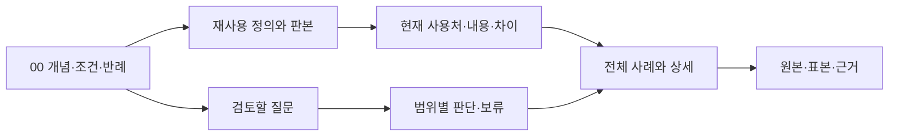

# draft.13 후보 — 00 지식에서 사례·사용처·검수까지

**선택하신 연결 구조를 후보 스킬과 기존 기록에 반영했다.** 기존 draft.12는 백업했고 신규 draft.13을 별도로 만들었다. 실제 사용판은 draft.10 유지다. 정본 등록·전편 확장·새 화면/영상 제작은 하지 않았다. 보고는 Markdown이며 PDF는 만들지 않았다.

## 무엇이 달라졌는가

분석 시작에 기존 개념/관련 심화·사용처를 조회하고, 정보 관계와 격자·표현 언어·모션을 구분해 수집한 뒤 정의/판본→현재 사용처/차이→근거→선택한 검토 질문과 실제 판정을 연결한다. 기본은 Markdown이며 이번처럼 조회 구현을 요청받으면 부속 기계 색인을 사용한다.

기존 조회 초안이 별도로 있던 상태에서 **스킬의 진입 지침·기록 계약·카탈로그/검사/색인/조회 도구**로 연결했다. 167개 기본 개념과11개 관련 문맥의 위치/해시를 제공한다. 모든 지식을 매 장면 일괄 적용하지 않고 미분류·미관측·권한/정밀 미상을 보존한다. [반영 범위와 남은 지식](02_00지식_반영범위.md).

## 실제 기록부터 보기

- [134초: 두 역할판의 요청·지원](pilot/case-134.md) — 정보 관계/격자/타입·색·재질 조합, 업무 묶음/방향 라벨/타일의 사용처와 조건.
- [172초: 성과값·회사열·건물](pilot/case-172.md) — 공간 무대·주수치·지원 명찰의 역할, 건물/기단과 명찰 분리, 앞 사례와 공통 표현/차이.
- [모션6개 창](pilot/motion-windows.md) — 전체 흐름6개와 그 아래 독립 세부4개, 수치 정착 이후 도상/카드의 후속 관계. 기존 관측 재편집이며 새 전편 관측이 아니다.
- [조회 명령과 읽는 법](04_조회실행안내.md) — 단위→사용처/시각/차이→근거 및 질문→실제 판정 반환.

위 `pilot/`은 부모가 기존 기록을 재편집한 시범이다. 스킬이 독립 실행한 평가 출력은 아래 비교 페이지에서 따로 본다. 원본 전체 상세·과거 실패·입력 기록은 보존했다. 두 정지 표본의 실제 모션은 미관측이다.

## 확인 결과와 한계

구조/참조/조회 경계29개 조건을 확인했다. 잘못된 개념/단위 참조, 증거 없는 관측, 원칙을 관측 유형으로 쓰기, 실제 검토 없이 평가 연결, 자동 회사 승인, 역전 시간, 변경된 근거/카탈로그/색인 등을 거부했다. 기존 관측JSON0.4의 판본 호환 경로도 확인했다. 이는 시각 의미/디자인 효과/R4통합v0.2 적합성 검사가 아니다. [검사 결과](validation-summary.json).

같은 두 과제를 draft.12/13에 각각 새 문맥으로1회 실행했다. 두 화면 과제와 모션6창 과제 모두 양쪽12/12로 동률이다. 후보는 공통 번들 도구를 사용했고 기존판은 과제별 조회 도구를 작성했다. 기능 재사용은 확인했지만 시간/비용 절감이나 전체 정확도 우월성은 입증하지 않았다.

별도 검토는 후보의 조회 설명/판본 표현3건, 기존판의112초 접근 가능성 표현1건을 지적했다. 원 결과를 보존하고 [정정·평가 한계](03_실행결과_정정과_평가한계.md)에 남겼다. 또한 ‘기록을 잘 보존했다’는 판정과 ‘원칙의 질문에 답했다’는 판단은 다르다. [원칙 적용성을 실제로 검토하는 별도 예](05_원칙검토의_실제예.md)를 함께 읽는다.

[실제 실행 비교 페이지](review.html) · [비교표/한계](company-video-grammar-analyzer-workspace/iteration-4/benchmark.md). 평가 기준은 같고 판본/결과는 검토자에게 공개됐다. 사람 승인·다른 영상 holdout·반복 실행 분산·시청자 효과 검증은 아니다. 원시 실행 전체 로그/토큰/시간은 제공되지 않아 추정하지 않았다.

## 지금 남은 큰 작업

1. 조회 반환 설명/판본 요약, 기록 충실성과 원칙 적용성 판정의 구분을 더 강하게 검토하는 기준 보완.
2. 아직 분석하지 않은 사내 장면에서 새 기록/검색/검토가 통하는지 확인. 현재 모든 비교는 알려진 같은 자료다.
3. 필요하면 R4통합v0.2로의 검증된 이관과 회사 문법 검수/등록. 현재 부속 색인은 R4 정본을 대체하지 않는다.

어느 작업을 다음에 할지는 사용자 선택을 받는다. 실제 사용판 전환·전편 확장·신규 제작은 이번 완료 범위에 포함하지 않는다.
