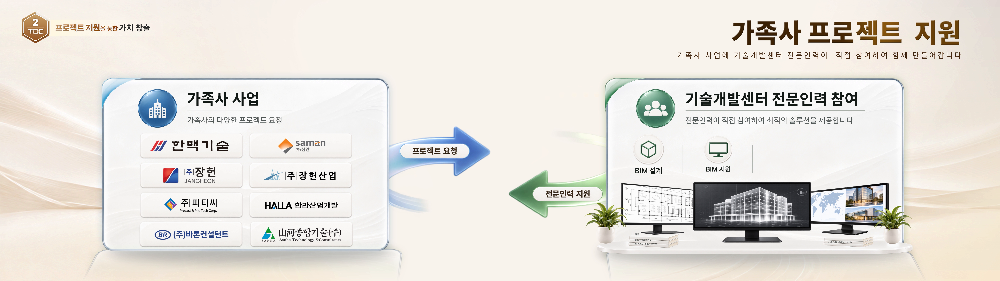

# 134·172초 — 지식과 사용처 수집

지정 스킬 draft.13으로 제공 PNG 두 장과 기존 수집 r2를 재대조한 로컬 초안이다. 읽는 순서: **이 요약 → [전체 상세](02_전체상세.md)·[정의/사용처](01_정의와사용처.md) → [근거/검토](03_근거와검토.md)**. [실제 조회 결과](05_조회안내.md)는 같은 구조의 JSON 색인으로 돌아간다. 기존 RC 번호/정의 v1을 유지했다.

## RC-CASE-001 · 134초

좌 가족사 사업과 우 기술개발센터 전문인력 참여는 파랑 ‘프로젝트 요청’ 우향 / 녹색 ‘전문인력 지원’ 좌향으로 연결된다. 크림 공간의 두 흰 유광 역할판, 중앙의 넓은 여백, 청/녹 원형 헤더와 굵은 역할명·회색 설명, 좌 로고2×4와 우 BIM항목·업무 이미지의 층이 전체 구도를 만든다. 두 역할의 연결이라는 기능 해석이며 우열 비교/업무순서/실제 움직임을 뜻하지 않는다.

찾을 단위는 **RC-LAYOUT-001@v1 역할판 구성**, RC-COMP-003@v1 역할헤더, RC-COMP-004@v1 방향라벨, **RC-COMP-007@v1 업무 이미지 묶음**이다. 모니터3대·책2묶음·화분2개·선반은007의 하위다. 분할+연결 구성은 조건부 분류이고 2×4는 왼쪽 부분의 기하격자다. 등장/정착/퇴장과 실제 소프트웨어정체는 미관측/미확인이다.

## RC-CASE-002 · 172초

실제 투입한 인력·비용 기준 **23.7억원을 가치창출성과로 산정했다**는 문구, 왼쪽 큰 금색입체값·중앙8회사 원근가로열·오른쪽 TDC 건물/기단의 가로무대다. 크림/금색 공간의 투명판·곡선받침·바닥반사·녹색유리·따뜻한 창빛이 깊이를 만든다. 기관 주변4명찰은 업무범주 주석이라는 해석이다. 실제부위별 업무/산정타당성/회사별기여비율은 확인하지 않았다.

**RC-LAYOUT-002@v1**, **RC-COMP-008@v1 건물/기단**, 별도 **RC-COMP-005@v1 지원명찰**, RC-COMP-006@v1 성과조형을 연결한다. 회사타일002는 E1과 핵심8로고가 반복되지만 2×4→원근가로열, HALLA/피티씨 순서가 다르다. 동일자산/이동/카운트업/빛·창내부변화는 미확인이다.

범위: 정지표본2장·ROI8개 및 번호/사용처/개념/검토의 왕복. 전편434.4초·134~172초연속검수·독립검수·회사승인·새자료 일반화시험은 아니다. 원본언어 유지/다른스타일 활용은 열어두되 현재 조건부후보의 의미·주체·단위를 보존한다.
